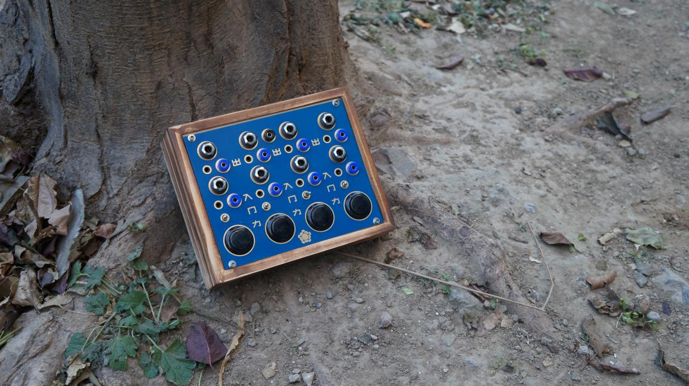
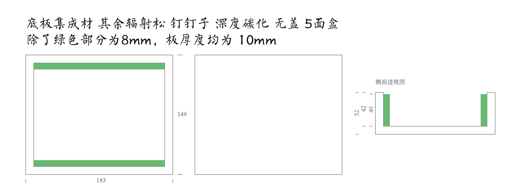

# Arcade Manifold

[English](README.md) | [中文](README_CN.md)



**Arcade Manifold** is a passive 4-channel Eurorack module (32HP) designed by [Meng Qi](https://www.mengqimusic.com). It works as a signal router, momentary switch, passive mixer, multiple, and format jumbler — built around fast, tactile SANWA arcade buttons for live performance.

Because the circuit is completely passive, it requires no power supply and can be mounted in an unpowered controller skiff or a standalone 32HP wooden box.

---

## Features & Controls

The module consists of **4 identical channels** arranged in columns, plus a shared **ground banana jack** at the top center for referencing external banana-format modular systems (Buchla, Serge, Ciat-Lonbarde, etc.).

Each column is labeled top-to-bottom on the faceplate with four Chinese characters:

| Label | Meaning | Control / Jacks |
| :---: | :--- | :--- |
| **出** | Output | 6.35 mm (1/4"), 3.5 mm (1/8"), and 4 mm banana jack (all three tied together) |
| **入** | Input | 6.35 mm (1/4"), 3.5 mm (1/8"), and 4 mm banana jack *(6.35 mm normaled to 3.5 mm; see below)* |
| **门** | Gate / Mode | DPDT toggle switch: **Normally Open** (press button to connect) or **Normally Closed** (press button to cut/mute) |
| **力** | Force / Action | **SANWA OBSF-24** 24 mm arcade pushbutton |

### Live Routing & Mixing

Using stackable banana cables, you can reconfigure the signal flow on the fly:

- **Pre-switch mixing (at the inputs):** Stack banana cables across channel inputs to mix signals before the switches, then route or punch that mix out to individual channels with the arcade buttons.
- **Post-switch mixing (at the outputs):** Stack banana cables across channel outputs to sum signals after the switches, using the arcade buttons to choose which voices enter the mix.
- **Format jumbling:** Convert between 3.5 mm Eurorack, 6.35 mm instruments/pedals, and 4 mm banana across inputs and outputs. On the input side, plugging a 6.35 mm cable breaks the 3.5 mm input normaling and takes priority over 3.5 mm (while the input banana jack remains active); on the output side, all three formats are always active simultaneously.
- **Multi-unit chaining:** Link multiple Arcade Manifold modules together across inputs, outputs, and ground — no power rails required.

---

## Circuit Overview

Each channel runs on an identical **Core PCB** mounted perpendicular to the **Faceplate PCB**.

- Every Core PCB holds **three 5.1 kΩ (1206) SMD resistors** (12 total for 4 channels):
  1. Between the input 6.35 mm / 3.5 mm jacks and the input banana pad (`Nana`)
  2. Between the input banana pad (`Nana`) and the toggle/button switch input
  3. Between the switch output and the output bus (`Nana` / 3.5 mm / 6.35 mm)
- **Input jack normaling:** On the input 6.35 mm jack, the switched tip contact (`TN`) connects to the 3.5 mm input while the main tip contact (`T`) connects through the 5.1 kΩ resistor to the input banana node. Unplugged, 3.5 mm passes through the normally closed switch contact; inserting a 6.35 mm plug disconnects the 3.5 mm input and takes over. On the output 6.35 mm jack, `T` and `TN` are shorted together on the PCB so all three output formats stay active at all times.
- **Switch modes:** In **Normally Open** mode, pressing the arcade button connects the channel input to the output. In **Normally Closed** mode, the signal passes through until the button is pressed, which shunts the internal switch node to ground. The series 5.1 kΩ resistors prevent external sources or passively mixed buses from shorting directly to ground.

---

## Repository Structure

```text
Arcade-Manifold/
├── README.md                                 # Project overview (English)
├── README_CN.md                              # Project overview (Chinese)
├── LICENSE                                   # MIT License
├── docs/
│   ├── diy-guide.md                          # Step-by-step assembly guide (English)
│   ├── diy-guide_CN.md                       # Step-by-step assembly guide (Chinese)
│   └── images/                               # Build photos & enclosure drawing preview
└── hardware/
    ├── BOM.csv                               # Complete Bill of Materials (with alternatives & dimensions)
    ├── core/
    │   ├── AM_Core_Gerbers.zip               # Ready-to-fab Gerber package (order 4x)
    │   ├── Arcade Manifold.lay6              # Sprint-Layout 6 source file
    │   └── gerbers/                          # Extracted Gerber & drill files
    ├── faceplate/
    │   ├── AM_Faceplate_Gerbers.zip          # Ready-to-fab Gerber package (order 1x)
    │   ├── AM Faceplate.lay6                 # Sprint-Layout 6 source file
    │   └── gerbers/                          # Extracted Gerber & drill files
    └── enclosure/
        └── AM_Box_32HP.pdf                   # 32HP wooden box vector drawing (PDF, editable in Illustrator/Inkscape)
```

---

## Bill of Materials (BOM)

Full machine-readable BOM (including drop-in alternatives and exact footprint/cutout dimensions): [`hardware/BOM.csv`](hardware/BOM.csv)

| Component | Brand / Model | Qty | Notes |
| :--- | :--- | :---: | :--- |
| Core PCB | Custom (`AM Core`) | 4 | 80.96 × 22.86 mm, 2-layer, 1.6 mm FR4 (1 per channel) |
| Faceplate PCB | Custom (`AM Faceplate`) | 1 | 162.5 × 128.7 mm (32HP × 3U), 2-layer, 1.6 mm FR4 |
| 5.1 kΩ SMD Resistor (1206) | Generic (`5K1 1206`) | 12 | 3 per Core PCB (all 3 resistor pads populated with 5.1 kΩ) |
| 24 mm Arcade Pushbutton | **SANWA** `OBSF-24` | 4 | Snap-in, 1 per channel |
| DPDT ON-ON Toggle Switch | **Dailywell** `2MD1T2B2M7QE` | 4 | Sub-miniature `M7` vertical right-angle, 1 per channel |
| 6.35 mm (1/4") Switched PCB Jack | [**REAN**](https://www.rean-connectors.com) (Neutrik) `NYS215` | 8 | 2 per Core PCB; replaces legacy Yongsheng `YS-215A` |
| 3.5 mm (1/8") Horizontal PCB Jack | Generic `PJ-313` | 8 | 5-pin horizontal DIP (unthreaded), 2 per Core PCB |
| 4 mm Banana Jack | **RCI** `R1-16A` | 9 | Panel-mount; 8 signal (e.g. blue) + 1 ground at top center (e.g. black) |
| Solid-core Bare / Tinned Wire | Generic | as needed | ~0.5–0.8 mm wire for buttons, banana jacks, and top ground jack |
| 32HP Wooden Box *(optional)* | Custom | 1 | Omit if installing into a Eurorack case |

*Optional accessories:* Stackable 4 mm banana patch cables (original builds shipped with 5) and 4× M3 Eurorack mounting screws (or wood screws for the wooden box).

---

## Sourcing & Compatibility Notes

Because this design originated in 2014–2017, check the exact mechanical dimensions below before substituting electromechanical parts:

- **6.35 mm jacks (`REAN NYS215`, formerly `Yongsheng YS-215A`):**
  - Ningbo Yongsheng has been consolidated into Neutrik's **REAN** brand; **`REAN NYS215`** (chrome ferrule nut, all contacts switched) is the current direct replacement.
  - **Measured Core PCB footprint:** 6-pin (`2 × 3`), **`17.0 mm`** row-to-row spacing, **`6.25 mm`** pin pitch (`12.50 mm` front-to-back), `4.35 mm` front-pin-to-board-edge, `Ø 1.50 mm` drill holes, **`8.2 mm`** center height above PCB, `Ø 11.3 mm` panel hole.
  - **Compatible drop-ins:** `REAN NYS215`, `REAN NYS216` / `NYS216G` (plastic nut), generic NYS215-footprint switched jacks (e.g. Tayda `A-7115`), or 4-pin mono `REAN NYS2152` / `NYS2162` (ring pads are unconnected on the Core PCB — verify `12.5 mm` front-to-back span against the datasheet).
  - **Not compatible:** Neutrik `NMJ6HCD2` / `NMJ6HC-S` (`16.23 mm` span, different pin layout), Neutrik `NRJ6HH` / `NRJ6HF` (slim body), Cliff S2/S4, and Amphenol ACJS.
  - **Electrical requirement:** Must be a **switched (normalling)** jack on the inputs; an unswitched 3-pin jack will leave the 3.5 mm input disconnected.
- **3.5 mm jacks (`PJ-313`):**
  - Uses a 5-pin **horizontal right-angle** unthreaded DIP jack (`PJ-313` / `PJ-313B`, two `Ø 1.6 mm` centering pegs, `~2.5 mm` center height, `Ø 5.5 mm` panel hole). **Not compatible** with vertical Eurorack Thonkiconn (`PJ398SM`) jacks.
- **DPDT toggle switches (`Dailywell 2MD1T2B2M7QE`):**
  - Sub-miniature `M7` vertical right-angle ON-ON DPDT (`2.54 × 5.08 mm` pin pitch + front locating pin, unthreaded flat bushing for `Ø 5.5 mm` panel hole). Direct equivalents include **Taiway `200-MDP1-T2B2M7QE`** and **Salecom `2MD1-T2-B2-M7-Q-E`**.
- **4 mm banana jacks (`RCI R1-16A`):**
  - The 2017 faceplate uses **double-D anti-rotation cutouts** measuring **`Ø 7.70 mm` × `6.10 mm` across flats**. Common US **Cinch Johnson `108-09xx`** banana jacks (`Ø 8.33 mm`) will **not** fit without reaming the panel holes.
- **24 mm arcade buttons (`SANWA OBSF-24`):**
  - Standard `Ø 24.2 mm` snap-in cutout; compatible with other 24 mm snap-in arcade buttons (e.g. Seimitsu `PS-14-DN`), though the module is designed around the feel of `SANWA OBSF-24`.

---

## PCB Fabrication Notes

Both PCBs were designed in **Sprint-Layout 6** (`.lay6`) and have had brand logos and compliance marks removed for open-source distribution. Ready-to-upload Gerber archives (including Excellon drill files) are included:

- **Core PCB** — [`hardware/core/AM_Core_Gerbers.zip`](hardware/core/AM_Core_Gerbers.zip)
  - Dimensions: `80.96 × 22.86 mm`, 2-layer, 1.6 mm FR4
  - Quantity needed: **4 per unit** (standard 5-piece fab minimum gives 1 spare)
- **Faceplate PCB** — [`hardware/faceplate/AM_Faceplate_Gerbers.zip`](hardware/faceplate/AM_Faceplate_Gerbers.zip)
  - Dimensions: `162.5 × 128.7 mm` (32HP × 3U), 2-layer, 1.6 mm FR4
  - Quantity needed: **1 per unit**
  - Finish: Front legends (**出 / 入 / 门 / 力**) and jack rings are exposed copper through solder-mask openings — **blue solder mask** with **HASL or ENIG** matches the original module.
  - Mechanical details: Includes 4 slotted Eurorack mounting holes (`5.2 × 3.2 mm`) and 9 double-D anti-rotation cutouts (`Ø 7.70 × 6.10 mm`).

---

## Assembly Guide

See the step-by-step illustrated build instructions in **[`docs/diy-guide.md`](docs/diy-guide.md)**.

---

## Optional 32HP Wooden Enclosure

Vector drawing: [`hardware/enclosure/AM_Box_32HP.pdf`](hardware/enclosure/AM_Box_32HP.pdf) *(clean vector PDF — opens directly in PDF viewers, Adobe Illustrator, Inkscape, or CAD/CAM tools)*.



**32HP box dimensions:**
- Outer dimensions: `183 × 149 × 52 mm` (open-top 5-sided box)
- Inner opening: `163 × 129 mm`, internal depth `42 mm`
- Wall thickness: `10 mm` charred radiata pine sides + `10 mm` laminated bottom panel
- Inner mounting rails (green): `8 mm` thick × `40 mm` tall (`2 mm` below the outer rim so the faceplate sits flush)

---

## License & Branding Policy

The hardware designs, Gerber files, and documentation in this repository are released under the [MIT License](LICENSE). Build and use these files at your own risk.

**Trademark & branding:** The MIT License covers the technical design only and does **not** grant trademark rights. All brand marks (the lotus logo, `孟` emblem, and factory `RoHS`/`WEEE` markings) have been removed from the public PCB and enclosure files. If you manufacture, sell, or distribute builds or kits based on this design, please use your own brand identity and **do not** place the **Meng Qi / MengQiMusic** name, lotus logo, or `孟` mark on third-party hardware. Attribution in documentation or product listings (e.g., *"Based on Arcade Manifold by Meng Qi"*) is welcome.
