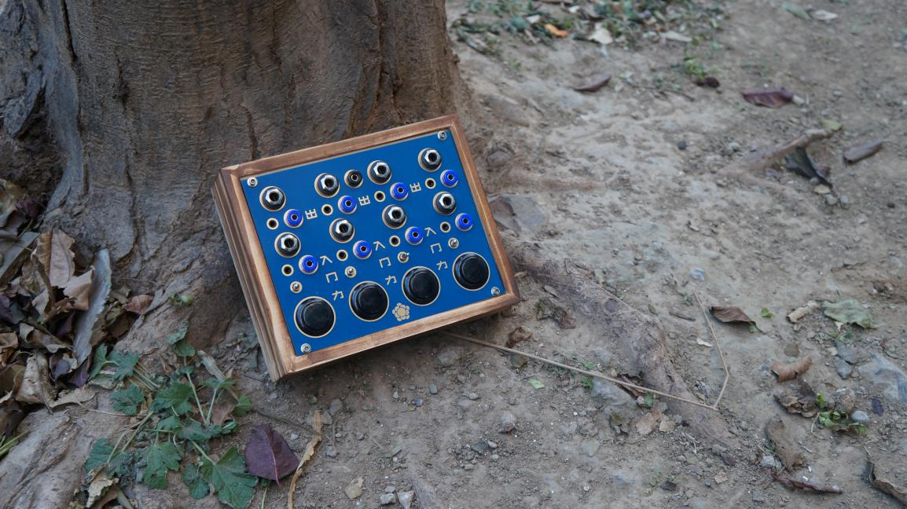
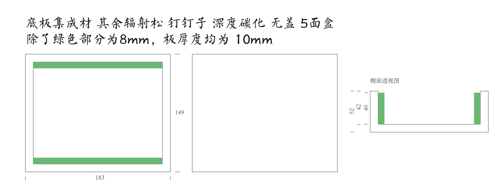

# Arcade Manifold

[English](README.md) | [中文](README_CN.md)



**Arcade Manifold** 是由 [Meng Qi（孟奇）](https://www.mengqimusic.com) 设计的 32HP 无源 4 通道 Eurorack 模块。它可以作为信号路由器、瞬时开关、无源混音器、信号复分器（Multiple）与多规格格式转换器使用，围绕手感干脆的 SANWA 街机按钮打造，适合快速、直接的现场演奏。

整套电路完全无源，无需接入电源，既可以直接装入不供电的控制器小盒，也可以放进 32HP 独立木盒中使用。

---

## 功能与面板说明

模块由 **4 个完全相同的纵向通道** 组成，面板顶部中央另设有一个 **接地香蕉座**，用于与 Buchla、Serge、Ciat-Lonbarde 等香蕉插口系统建立共地连接。

每个通道从上到下印有四个中文标识：

| 标识 | 含义 | 对应接口 / 控件 |
| :---: | :--- | :--- |
| **出** | 输出（Output） | 6.35 mm（大二芯）、3.5 mm（小二芯）与 4 mm 香蕉插口（三口始终并联） |
| **入** | 输入（Input） | 6.35 mm（大二芯）、3.5 mm（小二芯）与 4 mm 香蕉插口 *（6.35 mm 与 3.5 mm 之间为常闭转接，见下文）* |
| **门** | 开关模式（Mode） | DPDT 拨动开关：切换 **常开**（按下按钮导通）或 **常闭**（平时直通，按下按钮切断） |
| **力** | 触发演奏（Action） | **SANWA OBSF-24** 24 mm 街机按钮 |

### 现场路由与混音玩法

配合可叠插香蕉线，你可以随时改变信号流向：

- **输入端预混音**：在「入」区用香蕉线把多路信号叠插混合，再通过各通道的街机按钮把混合信号切分、路由到不同输出。
- **输出端后混音**：在「出」区用香蕉线把多个通道的输出并在一起，用街机按钮实时决定哪些信号进入最终混音。
- **跨格式跳线**：在输入与输出之间自由转接 3.5 mm（Eurorack）、6.35 mm（乐器/效果器）与 4 mm 香蕉系统。输入端插入 6.35 mm 插头时，会通过插座内部常闭开关断开 3.5 mm 输入并优先接入（输入香蕉口仍保持连通）；输出端三个规格始终同时有效。
- **多台串联**：多台 Arcade Manifold 可通过香蕉线与顶部接地口自由互联，且全部无需供电。

---

## 电路简述

每个通道使用一块独立 **Core PCB**，垂直安装在 **Faceplate PCB** 背面。

- 每块 Core PCB 上有 **3 颗 5.1 kΩ（1206）贴片电阻**（4 通道总计 **12 颗**）：
  1. 输入 6.35 mm / 3.5 mm 插座与输入香蕉焊盘（`Nana`）之间
  2. 输入香蕉焊盘（`Nana`）与开关/按钮输入端之间
  3. 开关输出端与输出总线（`Nana` / 3.5 mm / 6.35 mm）之间
- **输入 6.35 mm 常闭转接（Normaling）**：输入 6.35 mm 插座的常闭开关脚（`TN`）接输入 3.5 mm，主触点（`T`）经 5.1 kΩ 接输入香蕉节点。未插 6.35 mm 插头时，3.5 mm 经由常闭触点正常送入通道；插入 6.35 mm 插头后，常闭开关断开 3.5 mm，由 6.35 mm 接管。输出 6.35 mm 的 `T` 与 `TN` 在 PCB 上直接短接，因此三个输出接口始终保持并联。
- **开关模式**：**常开模式**下，松开按钮输入输出断开，按下导通；**常闭模式**下，松开按钮信号直通，按下按钮将内部开关节点拉低到地。串联的 5.1 kΩ 电阻既保证无源混音隔离，也避免外部信号源或输出混音总线被直接对地短路。

---

## 仓库目录

```text
Arcade-Manifold/
├── README.md                                 # 英文说明文档（主文档）
├── README_CN.md                              # 中文说明文档
├── LICENSE                                   # MIT 开源协议
├── docs/
│   ├── diy-guide.md                          # 英文 DIY 组装指南
│   ├── diy-guide_CN.md                       # 中文 DIY 组装指南
│   └── images/                               # 组装实拍图与木盒图纸预览
└── hardware/
    ├── BOM.csv                               # 完整元件清单（含替代型号与关键封装尺寸）
    ├── core/
    │   ├── AM_Core_Gerbers.zip               # Core PCB 打样 Gerber 压缩包（需 4 块）
    │   ├── Arcade Manifold.lay6              # Sprint-Layout 6 源文件
    │   └── gerbers/                          # 解压后的 Gerber 与钻孔文件
    ├── faceplate/
    │   ├── AM_Faceplate_Gerbers.zip          # Faceplate PCB 打样 Gerber 压缩包（需 1 块）
    │   ├── AM Faceplate.lay6                 # Sprint-Layout 6 源文件
    │   └── gerbers/                          # 解压后的 Gerber 与钻孔文件
    └── enclosure/
        └── AM_Box_32HP.ai                    # 32HP 木盒加工图纸（Illustrator / PDF）
```

---

## 元件清单（BOM）

完整表格文件（含替代料号与精确封装/开孔尺寸）：[`hardware/BOM.csv`](hardware/BOM.csv)

| 元件 | 品牌 / 型号 | 数量 | 说明 |
| :--- | :--- | :---: | :--- |
| Core PCB（核心板） | 定制（`AM Core`） | 4 | 80.96 × 22.86 mm，双层，1.6 mm FR4（每通道 1 块） |
| Faceplate PCB（面板） | 定制（`AM Faceplate`） | 1 | 162.5 × 128.7 mm（32HP × 3U），双层，1.6 mm FR4 |
| 5.1 kΩ 贴片电阻（1206） | 通用（`5K1 1206`） | 12 | 每块 Core PCB 3 处焊盘全部焊 5.1 kΩ（4 × 3 = 12） |
| 24 mm 街机按钮 | **SANWA** `OBSF-24` | 4 | 卡扣式安装，每通道 1 颗 |
| 迷你 DPDT 拨动开关（ON-ON） | **德利威（Dailywell）** `2MD1T2B2M7QE` | 4 | `M7` 垂直弯脚直插，每通道 1 颗 |
| 6.35 mm 全开关卧式 PCB 母座 | [**REAN**](https://www.rean-connectors.com.cn/?p=1505)（Neutrik）`NYS215` | 8 | 每块 Core PCB 2 个；原甬声 `YS-215A` 的现行替代型号 |
| 3.5 mm 卧式 PCB 母座 | 通用 `PJ-313` | 8 | 5 脚卧式直插无螺母，每块 Core PCB 2 个 |
| 4 mm 面板安装香蕉座 | **RCI** `R1-16A` | 9 | 8 个通道信号座（如蓝色）+ 1 个顶部中央接地座（如黑色） |
| 裸铜线 / 镀锡单芯硬导线 | 通用 | 若干 | 线径约 0.5–0.8 mm，用于按钮、香蕉座与顶部接地座飞线 |
| 32HP 木盒（可选） | 定制 | 1 | 若装入 Eurorack 机箱则无需木盒 |

*可选配件*：可叠插 4 mm 香蕉跳线（原版成品附带 5 根），以及 4 颗 M3 面板固定螺丝（木盒版可用自攻木螺丝）。

---

## 选料与替代说明

本设计最初定型于 2014–2017 年，采购机电件或寻找替代型号时请务必核对以下实测尺寸与约束：

- **6.35 mm 母座（`REAN NYS215`，原甬声 `YS-215A`）**：
  - 宁波甬声（Yongsheng）已整体并入 Neutrik 旗下 **REAN** 品牌，[**REAN NYS215**](https://www.rean-connectors.com.cn/?p=1505)（镀铬金属螺母、全开关 TRS）即为当年 `YS-215A` 的现行在产型号。
  - **Core PCB 实测封装**：6 脚双列直插（`2 列 × 3 排`），左右列距 **`17.0 mm`**，前后排距 **`6.25 mm`**（总跨度 `12.50 mm`），前排脚距板边 `4.35 mm`，钻孔 `Ø 1.50 mm`，轴心距 PCB 高度 **`8.2 mm`**，面板开孔 `Ø 11.3 mm`。
  - **可直接兼容替代**：`REAN NYS215`、`REAN NYS216` / `NYS216G`（塑料螺母版）、按上述尺寸筛选的通用 NYS215 兼容款（如 Tayda `A-7115`），或 4 脚单声道全开关版 `NYS2152` / `NYS2162`（Core PCB 中间两脚悬空，下单前请对照图纸确认前后跨度为 `12.5 mm`）。
  - **明确不兼容（注意避坑）**：Neutrik `NMJ6HCD2` / `NMJ6HC-S`（横向约 `16.23 mm` 且纵向步进不同）、Neutrik `NRJ6HH` / `NRJ6HF`（窄体 Slim Jack）、Cliff S2/S4、Amphenol ACJS，均无法直插。
  - **电气要求**：输入端**必须使用带常闭开关（Switched）的插座**，不可换成 3 脚无开关版，否则 3.5 mm 输入会断路。
- **3.5 mm 母座（`PJ-313`）**：
  - 采用 **5 脚卧式直插无螺母** 封装（`PJ-313` / `PJ-313B`，底部带 2 个 `Ø 1.6 mm` 居中定位柱，轴心高度约 `2.5 mm`，对应面板 `Ø 5.5 mm` 孔）。**与 Eurorack 常见的直立式 Thonkiconn（`PJ398SM`）完全不兼容**。
- **DPDT 拨动开关（`Dailywell 2MD1T2B2M7QE`）**：
  - 迷你 `M7` 垂直弯脚 ON-ON DPDT（脚距 `2.54 × 5.08 mm` + 前置定位脚，无螺纹平口套筒配 `Ø 5.5 mm` 面板孔）。同封装标准替代：**Taiway `200-MDP1-T2B2M7QE`**、**Salecom `2MD1-T2-B2-M7-Q-E`**。
- **4 mm 香蕉座（`RCI R1-16A`）**：
  - 2017 版面板开孔为 **双平边防转铣槽**：实测圆弧直径 **`Ø 7.70 mm`** × 双平边宽度 **`6.10 mm`**。海外常见的美标 **Cinch Johnson `108-09xx`** 系列（`Ø 8.33 mm`）**不扩孔装不进去**。
- **24 mm 街机按钮（`SANWA OBSF-24`）**：
  - 面板开孔 `Ø 24.2 mm`，兼容标准 24 mm 卡扣式街机按钮（如 Seimitsu `PS-14-DN`），但整体手感以 `SANWA OBSF-24` 为设计基准。

---

## PCB 打样说明

两块电路板均使用 **Sprint-Layout 6**（`.lay6`）绘制，仓库内已准备好可直接上传板厂的 Gerber 压缩包：

- **Core PCB** — [`hardware/core/AM_Core_Gerbers.zip`](hardware/core/AM_Core_Gerbers.zip)
  - 尺寸：`80.96 × 22.86 mm`，双层板，板厚 `1.6 mm` FR4
  - 需求数量：**每台 4 块**（板厂常见起订量 5 片，刚好留 1 片备用）
- **Faceplate PCB** — [`hardware/faceplate/AM_Faceplate_Gerbers.zip`](hardware/faceplate/AM_Faceplate_Gerbers.zip)
  - 尺寸：`162.5 × 128.7 mm`（32HP × 3U），双层板，板厚 `1.6 mm` FR4
  - 需求数量：**每台 1 块**
  - 工艺：正面字符（**出 / 入 / 门 / 力**、莲花标）与孔位装饰环均采用阻焊开窗露铜设计，**蓝油 + 喷锡或沉金** 可还原原版视觉。
  - 结构细节：四角采用 `5.2 × 3.2 mm` 标准 Eurorack 腰型安装槽孔，9 个香蕉座孔位带双平边防转铣槽（`Ø 7.70 × 6.10 mm`）。

---

## 组装指南

详细图文组装步骤与装机后万用表自检方法见 **[`docs/diy-guide_CN.md`](docs/diy-guide_CN.md)**。

---

## 可选 32HP 木盒图纸

加工源文件：[`hardware/enclosure/AM_Box_32HP.ai`](hardware/enclosure/AM_Box_32HP.ai)（内含完整 PDF 数据流，可直接用任意 PDF 阅读器打开查看矢量图）。



> **图纸注意**：画板里上下共画了两个木盒，**制作 Arcade Manifold 请看上方 `183 × 149 × 52 mm` 的图纸**。下方 `173 mm` 带侧面圆孔的盒子属于另一款 30HP 模块，请直接忽略。

**32HP 木盒参数（上方图纸）：**
- 外径：`183 × 149 × 52 mm`（无盖 5 面盒）
- 内径：`163 × 129 mm`，内深 `42 mm`
- 板材与工艺：四周为 `10 mm` 厚辐射松、底板为 `10 mm` 集成材（底面雕刻莲花标），表面深度碳化
- 内侧安装支条（图中绿色）：厚 `8 mm`、高 `40 mm`（比盒口低 `2 mm`，拧上面板后恰好与盒沿齐平）

---

## 开源协议

本项目基于 [MIT License](LICENSE) 开源。请自行评估并承担制作与使用这些硬件文件的风险。
