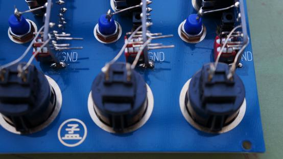
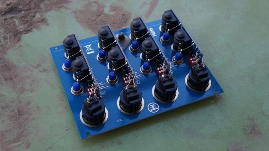
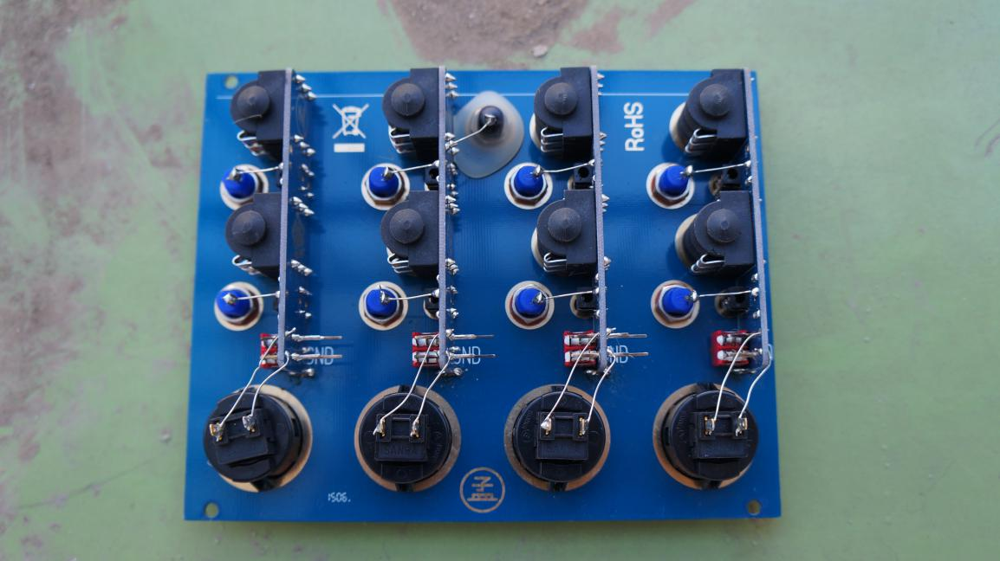
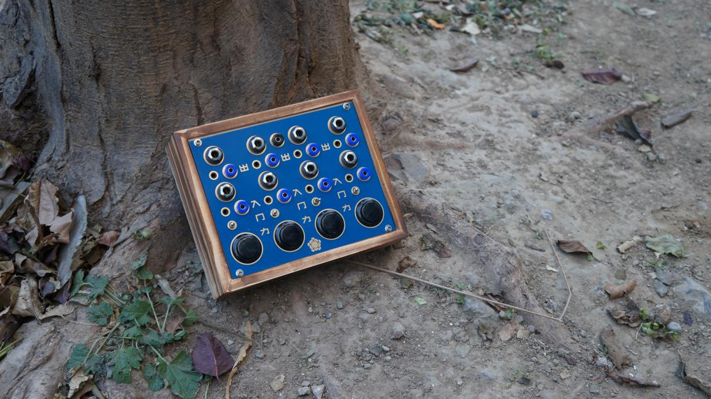

# Arcade Manifold — DIY Build Guide

[English](diy-guide.md) | [中文](diy-guide_CN.md)

This guide covers assembling one **Arcade Manifold** module from the PCBs and parts listed in [`hardware/BOM.csv`](../hardware/BOM.csv) (see the main [README](../README.md#sourcing--compatibility-notes) for part substitution and mechanical compatibility notes before ordering).

> **Note on photos:** The build photos below show an earlier original-factory faceplate batch with round corner mounting holes and brand markings. The public Gerber files in this repository use the updated 2017 mechanical layout (slotted Eurorack mounting holes and `Ø 7.70 × 6.10 mm` double-D banana cutouts) with brand logos and compliance marks removed — all assembly and wiring steps are identical.

---

## Step 1 — Populate the 4 Core PCBs

Each channel uses one Core PCB (`80.96 × 22.86 mm`). Repeat for all 4 boards:

1. **Solder the three 5.1 kΩ (1206) SMD resistors** first while the board is flat.
   - All **3** resistor footprints on each Core PCB take **5.1 kΩ** (12 resistors total across the 4 boards).
2. **Place the through-hole hardware** on the silkscreen side of the Core PCB:
   - 2× `REAN NYS215` (formerly `Yongsheng YS-215A`) switched 6.35 mm jacks *(verify switched/normalling tip contact for the input jack)*
   - 2× `PJ-313` horizontal 5-pin 3.5 mm jacks (align the jack front with the arrow `↑` on the silkscreen)
   - 1× `Dailywell 2MD1T2B2M7QE` (or equivalent `M7` right-angle) DPDT toggle switch
3. **Alignment tip:** Tack only one pin of each jack/switch first, or test-fit the Core PCB against the faceplate with the nuts finger-tight before soldering all remaining pins. This keeps all jacks and toggles square to the faceplate without mechanical stress.

---

## Step 2 — Install the Banana Jacks on the Faceplate

Install all **9× `RCI R1-16A`** banana jacks onto the faceplate:
- 8 signal jacks (2 per channel: Input and Output — e.g. blue)
- 1 ground jack at the top center (e.g. black)

Align the flat sides of each jack body with the double-D cutouts in the faceplate (`Ø 7.70 × 6.10 mm`) and tighten the rear nuts securely.

---

## Step 3 — Mount the Core PCBs to the Faceplate

Place the 4 populated Core PCBs onto the back of the faceplate so each board sits along its white vertical alignment line, with the `PJ-313` / `NYS215` / toggle bushings passing through the panel holes. Fasten the 6.35 mm mounting nuts on the front side.

---

## Step 4 — Solder the Ground Pads Between Core and Faceplate PCBs

At the bottom edge of each alignment line (labeled `GND` on the back of the faceplate), the top-corner ground pad of each Core PCB meets the exposed `GND` pad on the faceplate at a right angle.

Bridge all 4 joints cleanly with solder. This ties all 4 Core PCBs to the faceplate ground plane and adds mechanical rigidity.

---

## Step 5 — Install the Arcade Buttons and Complete Point-to-Point Wiring

1. **Snap in the 4× `SANWA OBSF-24` arcade buttons** from the front of the faceplate into the Ø 24.2 mm cutouts.
2. Using solid-core bare or tinned copper wire (~0.5–0.8 mm), wire the remaining connections on the back:
   - **Arcade buttons (4×):** Connect the two terminals of each button to the two large pads at the switch end of its Core PCB (polarity does not matter).
   - **Channel banana jacks (8×):** Connect each Input and Output banana jack lug to the corresponding `Nana` pad on its Core PCB.
   - **Top center ground banana jack (1×):** Run a wire from the top center banana jack to the `GND` pad at the top end of an adjacent Core PCB (in the reference build below, it is wired to the second Core PCB from the left and insulated/secured with hot glue around the base).

---

## Step 6 — Verification (Multimeter Check)

Before patching into your system, do a quick passive resistance check with a multimeter (no power needed):

1. **Ground continuity:** Verify continuity (`~0 Ω`) between the top center ground banana jack, every 3.5 mm / 6.35 mm sleeve, and the `GND` solder joints.
2. **Input normaling (6.35 mm ↔ 3.5 mm):**
   - Nothing plugged into Input 6.35 mm: Input 3.5 mm tip to Input banana reads **~5.1 kΩ**.
   - Plug a 6.35 mm cable into Input 6.35 mm: Input 3.5 mm tip to Input banana reads **open (`OL`)**, while the inserted 6.35 mm plug tip to Input banana reads **~5.1 kΩ**.
3. **Normally Open (toggle position 1):**
   - Button released: Input banana to Output jacks reads **open (`OL`)**.
   - Button pressed: Input banana to Output jacks reads **~10.2 kΩ** (`5.1 kΩ + 5.1 kΩ`).
4. **Normally Closed (toggle position 2):**
   - Button released: Input banana to Output jacks reads **~10.2 kΩ**.
   - Button pressed: Internal switch node is grounded — Input banana to GND reads **~5.1 kΩ**, Output jacks to GND read **~5.1 kΩ** (and active Input 6.35 mm / 3.5 mm to GND reads **~10.2 kΩ**).

---

## Step 7 — Install into Case

Mount the finished module into a standard **32HP Eurorack case** using M3 screws, or fasten it into the optional **32HP wooden box** ([`hardware/enclosure/AM_Box_32HP.pdf`](../hardware/enclosure/AM_Box_32HP.pdf)).

