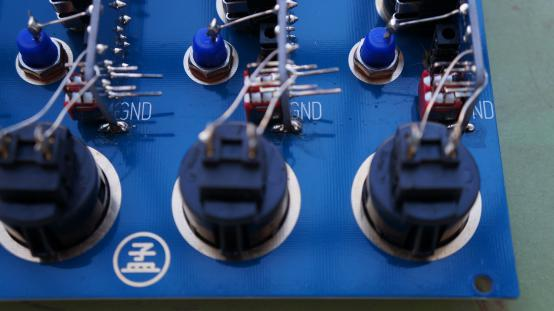
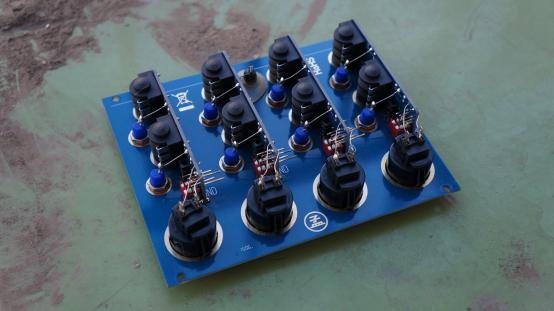
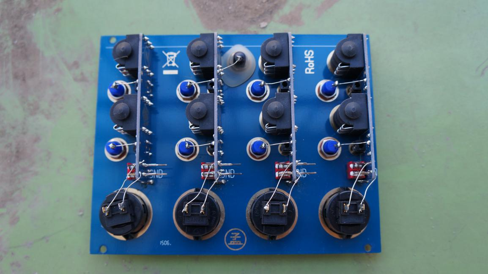
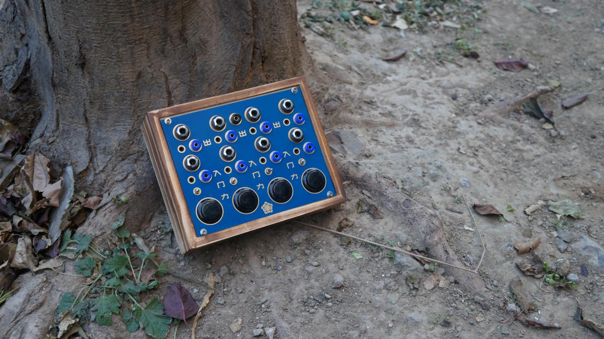

# Arcade Manifold — DIY 组装指南

[English](diy-guide.md) | [中文](diy-guide_CN.md)

本指南说明如何用仓库中的 PCB 文件与 [`hardware/BOM.csv`](../hardware/BOM.csv) 所列元件，组装一台完整的 **Arcade Manifold**（采购前建议先看 [README_CN.md](../README_CN.md#选料与替代说明) 中的替代型号与封装兼容提示）。

> **关于配图**：实拍图来自早期面板（圆孔、带 Logo）；仓库里的 Gerber 为腰型安装孔且无 Logo，焊接与接线步骤相同。

---

## 第一步：焊接 4 块 Core PCB

每块 Core PCB（`80.96 × 22.86 mm`）对应一个通道，共 4 块，操作完全相同：

1. **先焊贴片电阻**：在板面平整时，焊好每块 Core PCB 上的 3 颗 `5.1 kΩ`（1206）贴片电阻（4 块板共 12 颗）。
2. **放置插件元件**（安装在丝印面）：
   - 2 个 `REAN NYS215` 6.35 mm 全开关卧式母座 *（输入端必须为带常闭开关触点的插座）*
   - 2 个 `PJ-313` 5 脚卧式 3.5 mm 母座（插口朝向与丝印箭头 `↑` 一致）
   - 1 个 `Dailywell 2MD1T2B2M7QE`（或同封装 `M7` 弯脚）DPDT 拨动开关
3. **防歪技巧**：插件先轻点 1 个引脚固定，或直接先套到面板上拧上 6.35 mm 螺母定位，再把剩余引脚全部焊牢，避免装上面板时产生机械应力。

---

## 第二步：在面板上安装香蕉座

在面板上装入全部 **9 个 `RCI R1-16A` 香蕉座**：
- 8 个通道信号座（每通道入/出各 1 个，例如蓝色）
- 1 个顶部中央接地座（例如黑色）

对准面板上的双平边防转孔位（`Ø 7.70 × 6.10 mm`）装入，从背面拧紧螺母。

---

## 第三步：把 4 块 Core PCB 固定到面板背面

将焊好的 4 块 Core PCB 垂直装到面板背面，对齐面板背面的 4 条白色校准线，使 `PJ-313`、`NYS215` 与拨动开关套筒穿过面板孔位，从正面拧紧 6.35 mm 插座固定螺母。

---

## 第四步：焊接 Core PCB 与面板背面的 GND 焊盘

每条校准线下方标有 `GND` 的位置，Core PCB 边缘的直角接地焊盘正好与面板背面的 `GND` 焊盘相接。

用焊锡将 4 处直角焊盘分别可靠桥接焊牢，既让 4 块 Core PCB 与面板地平面完全共地，也能加固机械结构。

---

## 第五步：装入街机按钮并完成飞线连接

1. **卡入街机按钮**：从面板正面将 4 颗 `SANWA OBSF-24` 按钮直接按入 Ø 24.2 mm 圆孔卡紧。
2. 用单芯裸铜线或镀锡硬导线（约 0.5–0.8 mm）完成背面连线：
   - **街机按钮（4 颗）**：每颗按钮的 2 个焊脚接到对应 Core PCB 底端（靠近拨动开关一侧）的 2 个大焊盘上，不分正负。
   - **通道香蕉座（8 个）**：每个通道的输入、输出香蕉座焊尾分别连到对应 Core PCB 上标有 `Nana` 的焊盘。
   - **顶部中央接地香蕉座（1 个）**：用一根导线接到相邻 Core PCB 顶部标有 `GND` 的焊盘（参考下图，连至左起第 2 块 Core PCB 顶部 `GND` 焊盘，并在座体根部点热熔胶固定防松动与防短接）。

---

## 第六步：万用表通断与阻值自检

装入机箱前，用万用表电阻/通断档快速检查各通道（无需通电）：

1. **共地导通**：顶部中央接地香蕉座、所有 3.5 mm / 6.35 mm 插座外壳地（Sleeve）以及面板 `GND` 焊点之间应彼此导通（`~0 Ω`）。
2. **输入 6.35 mm 常闭转接检查**：
   - 输入 6.35 mm 未插线时：输入 3.5 mm Tip 到输入香蕉口约为 **`5.1 kΩ`**。
   - 输入 6.35 mm 插入一根 6.35 mm 插头后：输入 3.5 mm Tip 到输入香蕉口应变为**断开（`OL`）**，而所插 6.35 mm 插头 Tip 到输入香蕉口约为 **`5.1 kΩ`**。
3. **常开档（拨动开关档位 1）**：
   - 松开按钮：输入香蕉口到输出端之间应为**断开（`OL`）**。
   - 按下按钮：输入香蕉口到输出端之间阻值约为 **`10.2 kΩ`**（两颗 `5.1 kΩ` 串联）。
4. **常闭档（拨动开关档位 2）**：
   - 松开按钮：输入香蕉口到输出端之间阻值约为 **`10.2 kΩ`**。
   - 按下按钮：内部开关节点接地——此时输入香蕉口对地约 **`5.1 kΩ`**，输出端对地约 **`5.1 kΩ`**（当前有效的输入 6.35 mm 或 3.5 mm 对地约 **`10.2 kΩ`**）。

---

## 第七步：装入机箱或木盒

用 M3 螺丝将模块安装进标准 **32HP Eurorack 机箱**，或装入可选的 **32HP 独立木盒**（图纸见 [`hardware/enclosure/AM_Box_32HP.pdf`](../hardware/enclosure/AM_Box_32HP.pdf)）。

